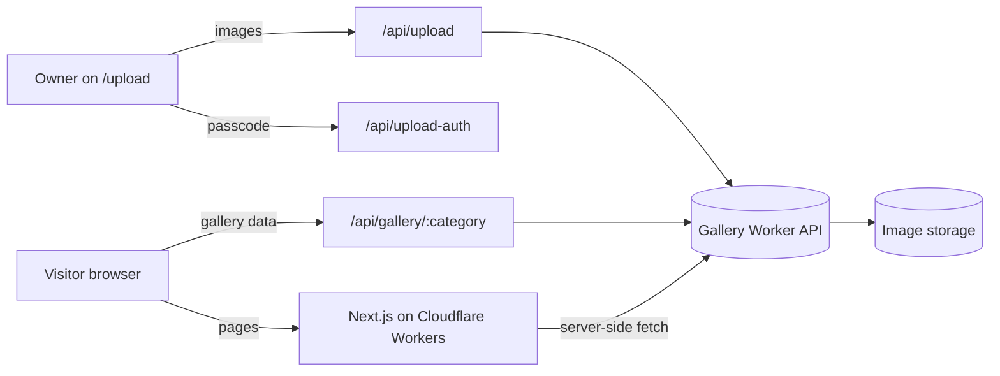

<div align="center">


# SR Builders: Construction Company Website

**A premium, fast, and responsive website for a London-based construction company, with service pages, a dynamic project gallery, and a passcode-protected image upload page.**

🌐 **Live site:** [srbuilders.london](https://srbuilders.london/)


</div>

---

## 📖 Table of Contents

- [Overview](#-overview)
- [Features](#-features)
- [Pages & Routes](#-pages--routes)
- [Tech Stack](#-tech-stack)
- [Architecture](#-architecture)
- [Project Structure](#-project-structure)
- [Getting Started](#-getting-started)
- [Environment Variables](#-environment-variables)
- [Scripts](#-scripts)
- [Deploying to Cloudflare](#-deploying-to-cloudflare)
- [Gallery Worker API Contract](#-gallery-worker-api-contract)
- [Customizing Content](#-customizing-content)
- [Design System](#-design-system)
- [Security Notes](#-security-notes)
- [Roadmap](#-roadmap)
- [License](#-license)

---

## 🧭 Overview

**SR Builders** is a marketing and portfolio website for a premium construction company serving residential and commercial clients in London. It presents the company's services, showcases completed work in category-based galleries, and gives the team a simple, private way to upload new project photos without touching code.

The site is built with **Next.js (App Router)** and deployed to **Cloudflare Workers** using **OpenNext**. Gallery images are stored and served by a separate **Cloudflare Worker API**, which this app talks to through its own server-side API routes.

---

## ✨ Features

**For visitors**
- **Elegant, responsive design.** A dark and gold theme with a serif display font and smooth Framer Motion animations.
- **Six service categories.** Residential Construction, Commercial Construction, Renovation & Remodeling, Painting, Electrical, and Plumbing, each with a description and key points.
- **Category galleries.** A masonry layout with a full-screen lightbox, keyboard navigation (`←` `→` `Esc`), and lazy-loaded images.
- **Home gallery preview** and an About page with company values, process, and highlights.
- **Floating social buttons and contact links** for WhatsApp, Facebook, and Instagram.
- **SEO and social sharing.** Per-page metadata and Open Graph tags with a branded 1200×630 preview image.

**For the business owner**
- **Private upload page** at `/upload`, protected by a passcode.
- **Multi-image upload** (JPG, PNG, WEBP) with live previews and a category picker.
- **No redeploy needed.** Uploaded images appear in the matching gallery straight away.

**For developers**
- **Content-as-data.** Services, navigation, brand info, and About copy all live in typed files under `data/`.
- **Runtime-safe environment access** that works both in local Next.js dev and on Cloudflare Workers bindings.
- **Server-side proxy routes**, so the Worker API URL is never hard-coded in the browser.

---

## 🗺 Pages & Routes

### Pages

| Route                  | Description                                                       |
| ---------------------- | ----------------------------------------------------------------- |
| `/`                    | Home: hero, about teaser, services overview, gallery preview, contact |
| `/about`               | Company values, process, and highlights                           |
| `/services`            | Detailed service cards with links to each gallery                 |
| `/gallery`             | Redirects to `/gallery/residential-construction`                  |
| `/gallery/[category]`  | Masonry gallery for one category (dynamically rendered)           |
| `/upload`              | Passcode-protected image upload page                              |

Valid gallery categories: `residential-construction`, `commercial-construction`, `renovation-remodeling`, `painting`, `electrical`, `plumbing`.

### Internal API routes

| Method | Route                     | Purpose                                                                  |
| ------ | ------------------------- | ------------------------------------------------------------------------ |
| `GET`  | `/api/gallery/[category]` | Proxies to the Worker API and returns `{ category, images }`             |
| `POST` | `/api/upload`             | Forwards multipart form data (`category`, `files`) to the Worker API     |
| `POST` | `/api/upload-auth`        | Checks a submitted passcode against `UPLOAD_PASSCODE`; returns `{ ok }` |

---

## 🛠 Tech Stack

| Area        | Technology                                                    |
| ----------- | ------------------------------------------------------------- |
| Framework   | Next.js 15 (App Router), React 19                             |
| Language    | TypeScript 5                                                  |
| Styling     | Tailwind CSS 3 with CSS-variable design tokens                |
| Animation   | Framer Motion                                                 |
| Icons       | Lucide React                                                  |
| Fonts       | Inter and Cormorant Garamond (via `next/font/google`)         |
| Hosting     | Cloudflare Workers through `@opennextjs/cloudflare`           |
| Tooling     | Wrangler, ESLint (`eslint-config-next`), PostCSS, Autoprefixer |

---

## 🏗 Architecture



**How it fits together**

1. The website is a Next.js app compiled for Cloudflare Workers with OpenNext.
2. Image storage lives in a **separate Gallery Worker** (not part of this repository). The website reaches it through the `GALLERY_WORKER_API_URL` variable.
3. Gallery pages fetch images **on the server** with `cache: "no-store"` and are marked `force-dynamic`, so new uploads show up immediately.
4. The upload page posts to `/api/upload`, which forwards the files to the Worker.

---

## 📁 Project Structure

```
Construction-Builders-Web/
├── app/
│   ├── layout.tsx                  # Root layout, fonts, global metadata, Open Graph
│   ├── page.tsx                    # Home page
│   ├── about/page.tsx
│   ├── services/page.tsx
│   ├── gallery/
│   │   ├── page.tsx                # Redirects to the first category
│   │   └── [category]/page.tsx     # Category gallery (server-rendered)
│   ├── upload/page.tsx             # Passcode-gated upload UI
│   ├── api/
│   │   ├── gallery/[category]/route.ts
│   │   ├── upload/route.ts
│   │   └── upload-auth/route.ts
│   └── globals.css
├── components/
│   ├── layout/                     # Navbar, Footer, FloatingSocials
│   └── gallery/                    # MasonryGallery (lightbox), HomeGalleryPreview
├── data/
│   ├── data.ts                     # Brand info, contact details, social links
│   ├── services.ts                 # Service items (slug, copy, image, bullet points)
│   ├── navigation.ts               # Nav links and gallery dropdown
│   └── about.ts                    # About page content
├── lib/
│   ├── runtime-env.ts              # Reads env from Cloudflare bindings or process.env
│   ├── gallery-api.ts              # Resolves the Gallery Worker API URL
│   └── motion.ts                   # Shared Framer Motion variants
├── public/                         # Logo, hero banner, service images, social preview
├── styles/theme.css                # Colour design tokens
├── tailwind.config.ts
├── next.config.mjs
├── open-next.config.ts             # OpenNext (Cloudflare) config
├── wrangler.jsonc                  # Cloudflare Worker config
└── .env.example
```

---

## 🚀 Getting Started

### Prerequisites

- **Node.js** 20 or newer
- **npm**
- A deployed **Gallery Worker API** (see the [API contract](#-gallery-worker-api-contract)) if you want galleries and uploads to work

### Installation

```bash
# 1. Clone the repository
git clone https://github.com/Puviraj-2004/Construction-Builders-Web.git
cd Construction-Builders-Web

# 2. Install dependencies
npm install

# 3. Create your environment file
cp .env.example .env.local        # on Windows: copy .env.example .env.local

# 4. Edit .env.local with your values (see below)

# 5. Start the development server
npm run dev
```

Open **http://localhost:3000** in your browser.

> Without a Gallery Worker URL the site still runs, but gallery pages will show no images and uploads will return an error.

---

## 🔐 Environment Variables

Copy `.env.example` to `.env.local` and fill in the values:

| Variable                      | Required | Description                                                                 |
| ----------------------------- | -------- | --------------------------------------------------------------------------- |
| `GALLERY_WORKER_API_URL`      | Yes\*    | Base URL of the Gallery Worker API. Used by server-side code (preferred).   |
| `NEXT_PUBLIC_WORKER_API_URL`  | Fallback | Used if `GALLERY_WORKER_API_URL` is not set.                                |
| `UPLOAD_PASSCODE`             | Yes      | Passcode required to unlock the `/upload` page.                             |

\* At least one of the two Worker URL variables must be set. A trailing slash is removed automatically.

Example `.env.local`:

```env
GALLERY_WORKER_API_URL=https://your-gallery-worker.your-subdomain.workers.dev
NEXT_PUBLIC_WORKER_API_URL=https://your-gallery-worker.your-subdomain.workers.dev
UPLOAD_PASSCODE=choose-a-strong-passcode
```

**How values are resolved:** `lib/runtime-env.ts` first looks for a Cloudflare Worker binding and falls back to `process.env`. This is why the same code works in `npm run dev` and in production on Cloudflare.

---

## 📜 Scripts

| Command             | Description                                                           |
| ------------------- | --------------------------------------------------------------------- |
| `npm run dev`       | Start the Next.js dev server at `localhost:3000`                      |
| `npm run build`     | Create an optimized production build                                  |
| `npm start`         | Run the production build with the Next.js server                      |
| `npm run lint`      | Lint the project                                                      |
| `npm run preview`   | Build with OpenNext and preview locally in the Cloudflare runtime     |
| `npm run deploy`    | Build with OpenNext and deploy to Cloudflare Workers                  |

---

## ☁️ Deploying to Cloudflare

The project is configured for Cloudflare Workers (`wrangler.jsonc`, worker name `sr-builders`).

1. **Log in to Cloudflare**
   ```bash
   npx wrangler login
   ```

2. **Set runtime variables and secrets** on the deployed Worker:
   ```bash
   npx wrangler secret put UPLOAD_PASSCODE
   npx wrangler secret put GALLERY_WORKER_API_URL
   ```
   You can also add them in the Cloudflare dashboard under **Workers → sr-builders → Settings → Variables**. `keep_vars` is enabled, so dashboard variables are preserved across deploys.

3. **(Optional) Preview locally in the Workers runtime**. Put local values in a `.dev.vars` file (it is git-ignored):
   ```bash
   npm run preview
   ```

4. **Deploy**
   ```bash
   npm run deploy
   ```

5. **Connect your domain** (for example `srbuilders.london`) in the Cloudflare dashboard.

> The Open Graph URLs in `app/layout.tsx` point to `https://srbuilders.london/`. Update them if you deploy under a different domain.

---

## 🔌 Gallery Worker API Contract

The Gallery Worker is a separate service. This website expects it to expose:

### `GET /gallery/:category`

Returns the images for a category.

```json
{
  "category": "painting",
  "images": [
    {
      "key": "painting/1718000000-photo.jpg",
      "url": "https://cdn.example.com/painting/1718000000-photo.jpg",
      "uploadedAt": "2026-06-10T12:00:00.000Z",
      "size": 345678
    }
  ]
}
```

### `POST /upload`

Accepts `multipart/form-data` with:

| Field      | Type            | Description                                  |
| ---------- | --------------- | -------------------------------------------- |
| `category` | string          | One of the six service slugs                 |
| `files`    | file (repeated) | One or more JPG, PNG, or WEBP images         |

Returns JSON including an `uploaded` array (the site shows its length in the success message), or `{ "error": "..." }` with a non-2xx status on failure.

---

## ✏️ Customizing Content

Most content changes need no component edits:

| What you want to change                      | Where                                   |
| -------------------------------------------- | --------------------------------------- |
| Company name, tagline, description, logo     | `data/data.ts` → `brandData`            |
| Phone, email, address, social links          | `data/data.ts` → `contactData`, `socialLinks`, `contactSocialLinks` |
| Services (titles, copy, bullet points, image) | `data/services.ts`                      |
| Navigation and gallery dropdown              | `data/navigation.ts`                    |
| About page values, process, highlights       | `data/about.ts`                         |
| Logo, hero banner, social preview image      | `public/`                               |
| Page title, meta description, Open Graph     | `app/layout.tsx`                        |

**Adding a new service or gallery category**

1. Add an entry to `data/services.ts` with a unique `slug`, `image`, and `workHref` of `/gallery/<slug>`.
2. Add the matching link to `galleryItems` in `data/navigation.ts`.
3. Add an icon for it in the `serviceIcons` map in `app/page.tsx` (and in the services page if used).
4. Drop a service image in `public/images/services/`.
5. Make sure your Gallery Worker accepts the new category slug.

---

## 🎨 Design System

Colours are defined as RGB tokens in `styles/theme.css` and exposed through Tailwind (`tailwind.config.ts`).

| Token        | Value                  | Used for                    |
| ------------ | ---------------------- | --------------------------- |
| `primary`    | `#0B0B0B` (black)      | Page background             |
| `charcoal`   | `#1A1A1A`              | Cards and surfaces          |
| `gold` / `accent` | `#D4AF37`         | Highlights, labels, hover   |
| `cream` / `light` | `#F8F3E7`         | Light content sections      |
| `grey` / `sub` | `#BDBDBD`            | Secondary text              |

**Fonts:** Cormorant Garamond for headings (`font-display`) and Inter for body text (`font-sans`).

To re-theme the site, change the values in `styles/theme.css`.

---

## 🔒 Security Notes

- **The upload passcode is a light gate, not full authentication.** `/api/upload-auth` checks the passcode and the browser remembers the result in `sessionStorage`, but `/api/upload` itself does not re-check it. Anyone who calls `/api/upload` directly could submit files. For production use, consider validating the passcode (or a signed session token) inside `/api/upload` and enforcing file type and size limits on the Worker.
- Use a **strong, unique passcode** and store it as a **secret** (`wrangler secret put`), never in the repository. `.env*` files (except `.env.example`) are git-ignored.
- Keep the Gallery Worker URL server-side (`GALLERY_WORKER_API_URL`) where possible.

---

## 🗺 Roadmap

- [ ] Re-validate the passcode on `/api/upload` and add rate limiting
- [ ] Image delete and reorder from an admin view
- [ ] Contact / quote request form with email delivery
- [ ] Optimized image delivery (`next/image` or Cloudflare Images) in galleries
- [ ] Testimonials and project case-study pages
- [ ] Sitemap, `robots.txt`, and structured data (LocalBusiness) for SEO
- [ ] Automated tests and CI

---

## 📄 License

No license file is currently included in this repository. All content, including the logo, photographs, and brand copy, belongs to SR Builders. Add a `LICENSE` file if you intend to open-source the code.

---

<div align="center">

**SR Builders** · London, United Kingdom
Built by [Puviraj](https://github.com/Puviraj-2004)

</div>
